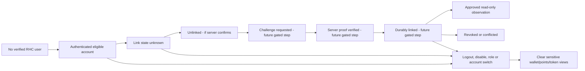

# W03 — Identity, Wallet-Link, Async Invalidation, and Presentation Rules

**Status: DESIGN RULES PROPOSED.** Offline controllers demonstrate boundary intent, not connected proof.

## Identity chain: four different identifiers

1. Supabase Auth `sub` (or provider session user) is an authentication subject, **not** the RHC app primary key. Boss Gal verifies JWT `iss`, `aud`, `kid`, algorithm, subject, time bounds and current user status server-side.
2. RHC `users.id` is a distinct backend-generated UUID; server uses it as the authorization and wallet link owner key. Browser cannot supply another owner's ID to select a balance.
3. `user_profiles.rhc_id` is a human-readable Digital RHC ID; it **does not** authenticate the user, prove property rights, or prove wallet ownership.
4. Thirdweb account/embedded/external wallet identifiers and `0x...` addresses are provider/wallet-side identities, not RHC App authentication. Browser `connected` **does not imply** durable `linked`.

## Proposed guarded state diagram



No link/proof/nonce endpoint in this diagram is implemented or approved. A mock `observeSyntheticLink('linked')` cannot advance to server-verified G.

## Mandatory frontend invalidation behavior (future tests)

- **Before** dispatching a request for another RHC account, clear old address, points balance/history, token balance/history, last-provider success and explorer identity; show loading/unknown instead of customer A's values.
- Scope every awaited result by a *locally captured* `(RHC user UUID, verified session epoch, wallet-link revision, selected chain/contract identity, data-source revision)` and an incrementing generation/cancellation marker. An older response never paints B's screen after A->B, logout, disable, revoked link, provider method/chain change or component unmount.
- On provider disconnect, do not assume backend link revocation; display statuses separately and follow a server-approved unlink policy. Never reuse synthetic per-handle cleanup rules for real Thirdweb wallet disconnect.
- On `401`, `403`, `409`, `429` or `503`, clear/withhold disallowed prior fields and display actionable but sanitized status. Do not silently fall back to fixtures or another company's records.
- A token read's provenance is indexed to `(chainId, contractAddress, walletAddress, blockHash/height, observationTime)`; wrong-chain or stale observations cannot be merged. A transfer's indexed log must also be bound to its source and block.
- Frontend fingerprint alone is **not an authorization primitive**, a cryptographic signature, or JWT revocation. The server must enforce user/resource checks on every operation.
- Demo route and connected route must have explicit source labeling and separate caches; never let a demo balance appear as real chain data.

## Future wallet proof design questions (NOT an implementation)

Boss Gal/security must specify one-time server challenge with a cryptographic nonce, strict TTL/replay consumption, audience/domain/origin, wallet address/chain and RHC `users.id` binding; signed intent, signature type (EOA / EIP-1271 if approved), ownership/uniqueness, same-account relink, unlink/recovery and audit. Never accept a browser `walletAddress` field as proof of control by itself. No signature or contract interaction is authorized by this document.

## Precise display contract

```
RHC Points:  0.00 points — posted synthetic read-only ledger projection (if observed)
Token:       Unavailable — no approved wallet/contract read (not "0 RHC")
History:     Not available — source is not enabled (not "No transactions")
Wallet link: Unknown — backend wallet link not implemented (not "Unlinked")
```

- `0`, `false` and an empty verified page are legitimate observed values only when the source explicitly reports them.
- `null`, `not_configured`, `unsupported`, `unavailable`, `stale`, `revoked`, `conflict` must remain visibly distinct.
- Timestamp freshness is a **last-read observation**; approved OFF-16 conservatively reclassifies older browser snapshots, not provider health or chain finality.
- No price, cash conversion, transfer, earn or redemption is implied by either points or the token view.

**Review gate:** Boss Gal approves identity and backend linkage semantics; Boss Allen approves wallet UI lifecycle; management/security approves privacy, provider and role policy before connected work.
